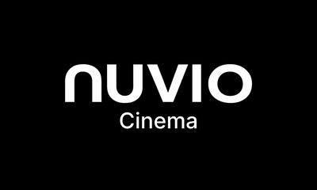

<p align="center">
  
</p>

# Nuvio Cinema

Nuvio Cinema is an independent, native Apple TV app for discovering movies and series and watching them through your Nuvio profile. Browse full-screen artwork, find a title with native tvOS search, and pick up a show where you left off.

**[Download for Apple TV](https://github.com/MagiqueDeveloper/NuvioCinema/releases/latest)** · [Build from source](#build-from-source) · [Open an issue](https://github.com/MagiqueDeveloper/NuvioCinema/issues/new/choose)

[](https://github.com/MagiqueDeveloper/NuvioCinema/actions/workflows/build.yml)

## What you can do

| Feature | Highlights |
| --- | --- |
| **Discover** | Start with Home’s daily featured lineup, trending titles, new releases, and Top Rated. Browse movies and series together across 14 genres. |
| **Find a title** | Search movies and series in one grid. Title pages bring together seasons, episodes, trailers, cast and crew, and related titles. |
| **Keep your place** | Link your Nuvio profile to sync Continue Watching, watch history, and your watchlist. Resume from the position saved when you paused or exited. |
| **Playback** | Start with title artwork and a live loading status. Use timeline previews, subtitle timing controls, and next-episode navigation. IntroDB adds intro and recap skips where markers are available. |

## Get started on Apple TV

### Install

1. Open the [latest GitHub release](https://github.com/MagiqueDeveloper/NuvioCinema/releases/latest) and download the attached `.ipa`.
2. Sign and install it with a sideloader that supports Apple TV. Nuvio Cinema requires **tvOS 18 or later**.
3. Open Nuvio Cinema once after installing. For Top Shelf, see [the signing requirements](#signing-for-top-shelf).

> [!NOTE]
> This README describes the current source tree. Release notes list the features included in each downloadable IPA.

### Link your account and play

You can browse the public catalogs online without signing in. When you’re ready to play, open **Settings → Link Nuvio Account**, scan the QR code, and approve the connection on Nuvio’s website. The selected profile supplies your enabled add-ons and synced library. Use **Sync Now** to refresh the profile on demand.

On a movie or episode, choose **Play** or **Resume**, then select a source. Direct HTTPS streams play in the bundled NuvioTVOS player, powered by AetherEngine and MPVKit. Provider links may open a compatible installed app, and trailers can open in YouTube.

### Siri Remote shortcuts

- **Hold a Continue Watching card** to start over, mark it watched, or remove it from the shelf.
- **Hold an aired episode** to mark it watched or unwatched, or mark episodes watched up to that point.
- **Press Down from Play or Resume** to reach the selected season, then press Down again to reach the current episode. Press Up from an episode to return to its season without moving the episode shelf sideways.

### Add Nuvio Cinema to Top Shelf

Move the app to the top row of the Apple TV Home Screen. Top Shelf shows featured titles from Cinema’s Home carousel with artwork and synopses. Choose **More Info** to open the title page.

## Build from source

You’ll need an **Apple silicon Mac**, **Xcode 27** with the tvOS SDK, **Tuist 4.207.0**, and **Python 3.9 or later**. CI uses Xcode 27.2. The first build needs internet access to fetch upstream source and resolve Swift packages.

### Generate the workspace

Generate the workspace from the repository root.

```sh
Scripts/prepare-upstream-player --generate
```

The script checks out the pinned NuvioTVOS revision, applies Cinema’s player patches in numeric order, and copies Cinema’s Swift sources into the generated workspace. When the patch set or upstream revision changes, it prepares a fresh checkout before replacing the old one. Previous checkouts are saved under `build/upstream-player-previous.*`.

### Run in the simulator

Open `.upstream-player/tvosApp/NuvioTV.xcworkspace` in Xcode. Select the **NuvioTV** scheme and an Apple TV simulator running **tvOS 18 or later**, then press **Run**.

Or build from the command line.

```sh
xcodebuild -workspace .upstream-player/tvosApp/NuvioTV.xcworkspace \
  -scheme NuvioTV \
  -destination 'generic/platform=tvOS Simulator' \
  build
```

Keep signing enabled and install updates over the existing simulator app with the same bundle ID and signing identity so Keychain can restore your Nuvio session.

After editing Cinema’s Swift code, run `Scripts/prepare-upstream-player` to refresh the source copies. Add `--generate` again when you add, move, or remove source files. The standalone `NuvioCinema.xcodeproj` builds the legacy player.

### Build and package for Apple TV hardware

Build an unsigned Release app for a generic Apple TV, then package it as an IPA.

```sh
xcodebuild -workspace .upstream-player/tvosApp/NuvioTV.xcworkspace \
  -scheme NuvioTV \
  -configuration Release \
  -destination 'generic/platform=tvOS' \
  -derivedDataPath build/device \
  CODE_SIGNING_ALLOWED=NO CODE_SIGNING_REQUIRED=NO \
  build

Scripts/package-ipa \
  build/device/Build/Products/Release-appletvos/NuvioCinema.app \
  build/NuvioCinema.ipa
```

The packager applies an ad hoc signature so the app and its Top Shelf extension carry the App Group entitlement into the IPA. Use a sideloader to apply device signing before installing it.

### Signing for Top Shelf

Keep `TopShelf.appex` embedded in the app. Both `com.nuviocinema.app` and `com.nuviocinema.app.TopShelf` need provisioning profiles that grant access to the same registered App Group. The default is `group.com.nuviocinema.app`.

If your signer changes the bundle IDs, keep the extension ID under the app’s bundle ID and use the same authorized App Group in both signatures. **Settings** reports when the extension is missing or the required App Group is unavailable. [Apple’s App Group documentation](https://developer.apple.com/documentation/xcode/configuring-app-groups)

## Contributing

Cinema’s Swift code lives in [`Sources/`](Sources), grouped by feature. Changes to the bundled player go in [`Scripts/Patches/`](Scripts/Patches). Run the `NuvioTV` scheme’s Test action on an Apple TV simulator to run the Cinema tests. The [Build tvOS workflow](.github/workflows/build.yml) runs these tests and compiles an unsigned Release build for Apple TV hardware.

Check UI changes with an Apple TV remote or the simulator. For a playback issue, include the tvOS version, player backend, and steps to reproduce it. Remove account details and private add-on URLs from logs before sharing them. Debug builds log public artwork and metadata cache hits, request counts, bytes, and rate limits under `PublicNetwork`.

## License and credits

Nuvio Cinema is distributed under the [GNU General Public License v3.0](LICENSE).

- **NuvioTVOS** provides the bundled player and Top Shelf extension. Cinema adapts its Nuvio wordmark for the app icon and uses a [pinned upstream revision](https://github.com/bobsupra/NuvioTVOS/tree/735adf8859462b5beb47dbc96a51c75ded15c685) with Cinema’s own integration and playback patches. Credit goes to the NuvioTVOS contributors. [Upstream project](https://github.com/bobsupra/NuvioTVOS)
- **Catalogs and artwork** come from [Cinemeta](https://v3-cinemeta.strem.io/) and [BetterPosters](https://btttr.cc/). [TVmaze](https://www.tvmaze.com/) and [Wikidata](https://www.wikidata.org/) supplement cast and crew details where available.
- **Third-party notices** for applicable dependencies are included in the generated app. [Repository notices](Resources/ThirdPartyNotices)
- **AI disclosure.** OpenAI Codex assisted with writing, debugging, reviewing, and documenting this project.
